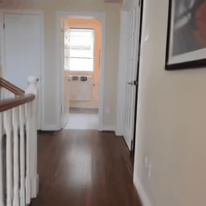
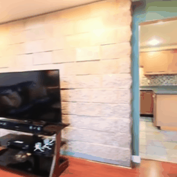
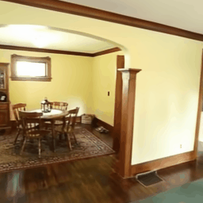

# TokenBloom

### Progressive Expansion of Spatial Tokens for Feed-Forward Gaussian Splatting

TokenBloom reconstructs a 3D Gaussian scene from two calibrated context images
and renders novel views.

## Visual Results

The following animations use two context images per scene. The camera starts
from a valid target pose and follows a local two-loop motion around it.

<p align="center">
  
  
  
</p>

<p align="center"><i>Novel-view renderings from three local RE10K scenes.</i></p>

> The included context images are RE10K-derived local examples. Please check
> the RE10K license before redistributing dataset assets or generated media.

## Main Pipeline

```text
Two context RGB images + camera intrinsics/extrinsics
                         |
                         v
        Image / ray feature encoder (DINOv2 + RGB patches)
                         |
                         v
     Per-patch depth and radius -> initial 3D anchor tokens
                         |
                         v
    Attention-based token refinement and adaptive token expansion
                         |
                         v
    Context rendering -> local error feedback -> token update
                         |
                         v
        Final tokens decode to 3D Gaussian primitives
                         |
                         v
                gsplat novel-view rasterization
                         |
                         v
                    RGB render + depth map
```

At a high level, image patches become depth-guided 3D tokens. The network
iteratively refines and expands those tokens, converts them to Gaussian
primitives, and uses render-to-context feedback to improve the token state
before the final novel-view rendering.

## RE10K Two-View Benchmark

TokenBloom achieves competitive two-view novel-view synthesis quality while
using substantially fewer Gaussian primitives than the listed token-based
baseline.

| Method | PSNR ↑ | SSIM ↑ | LPIPS ↓ | # Gaussians ↓ |
| :-- | --: | --: | --: | --: |
| MVSplat | 26.390 | 0.8690 | 0.1281 | 131K |
| DepthSplat | 27.470 | 0.8890 | 0.1141 | 131K |
| TokenGS | 28.410 | 0.9030 | 0.1352 | 262K |
| TokenBloom (ours) | 28.168 | 0.9013 | 0.1298 | 92K |

## Setup

The reference implementation was verified in the existing `tokengs` conda
environment with CUDA-enabled PyTorch.

```bash
conda activate tokengs
pip install -r TokenBloom/requirements.txt
```

Two dependency files are included:

- `requirements.txt`: concise runtime dependency list for a clean install.
- `requirements.lock.txt`: the complete `pip freeze --all` export from the
  verified `tokengs` environment (115 installed packages).

For the closest environment reproduction:

```bash
pip install -r TokenBloom/requirements.lock.txt
```

The lock file intentionally preserves the original environment exactly. It
contains machine-local package paths (including fused-SSIM and the original
`pip` build) plus the editable TokenGS repository reference; replace those
entries with your local equivalents if you create a clean environment.
TokenBloom inference itself does not invoke the training-only fused-SSIM path.

The DINOv2 source must also be importable. In this workspace it is available
at `dinov2/`; for a standalone release, install/clone the same DINOv2 source
or make it available through `PYTHONPATH`.

If the installed xFormers binary has no kernel for your GPU, prefix commands
with `XFORMERS_DISABLED=1`. The model will use the PyTorch attention fallback.

## Model Weights

Large binaries are not committed. Place them in the following paths, or pass
their paths explicitly to the scripts:

```text
TokenBloom/checkpoints/tokenbloom_re10k.safetensors
TokenBloom/weights/dinov2/dinov2_vitb14_pretrain.pth
TokenBloom/weights/torchvision/resnet18-f37072fd.pth
```

See [checkpoints/README.md](checkpoints/README.md) and
[weights/README.md](weights/README.md) for the expected layout.

## Inference: Two Context Views to a Novel View

The scene JSON contains exactly two context images with camera-to-world
matrices, plus one or more target cameras. An example is provided at
`examples/re10k_000103/scene.json`.

```bash
cd /path/to/TokenGS_728_train02_03

XFORMERS_DISABLED=1 conda run -n tokengs python TokenBloom/scripts/run_demo.py \
  --scene TokenBloom/examples/re10k_000103/scene.json \
  --output-dir TokenBloom/outputs/demo \
  --checkpoint /path/to/tokenbloom_re10k.safetensors \
  --dino-weights /path/to/dinov2_vitb14_pretrain.pth \
  --resnet-weights /path/to/resnet18-f37072fd.pth \
  --export-ply
```

Outputs:

```text
outputs/demo/render_000.png
outputs/demo/depth_000.png
outputs/demo/gaussians.ply       # when --export-ply is supplied
```

## Novel-View Animation

```bash
XFORMERS_DISABLED=1 conda run -n tokengs python TokenBloom/scripts/render_animation.py \
  --scene TokenBloom/examples/re10k_000103/scene.json \
  --output-dir TokenBloom/outputs/animation \
  --checkpoint /path/to/tokenbloom_re10k.safetensors \
  --dino-weights /path/to/dinov2_vitb14_pretrain.pth \
  --resnet-weights /path/to/resnet18-f37072fd.pth \
  --frames 96 --fps 16 --motion-fraction 0.20 --cycles 2
```

This writes `novel_view.gif` and `frames/*.png`. The defaults create a
roughly six-second GIF with a target-centered local camera path.

## Export a Local RE10K Example

If local RE10K `.torch` records are available, export a demo specification
with:

```bash
conda run -n tokengs python TokenBloom/scripts/export_re10k_demo.py \
  --scene-torch /path/to/re10k/test/000103.torch \
  --output-dir TokenBloom/examples/re10k_000103 \
  --context 0 20 --target 10
```

## Checks

```bash
PYTHONPATH=TokenBloom conda run -n tokengs python -m unittest \
  TokenBloom/tests/test_animation_unittest.py \
  TokenBloom/tests/test_config_unittest.py \
  TokenBloom/tests/test_cameras_unittest.py -v
```

## License

TokenBloom is released under the [Apache License 2.0](LICENSE). See
[NOTICE](NOTICE) for project attribution and distribution notes.

Third-party model weights, datasets, and other external assets are subject to
their respective licenses and are not covered by the TokenBloom license.

## Citation

If you find TokenBloom useful in your research or projects, please consider
citing:

```bibtex
@misc{zhang2026tokenbloom,
  title={TokenBloom: Progressive Expansion of Spatial Tokens for Feed-Forward Gaussian Splatting},
  author={Ziyuan Zhang},
  year={2026},
  note={Project page: https://github.com/ziyuan1111/TokenBloom-Progressive-Expansion-of-Spatial-Tokens-for-Feed-Forward-Gaussian-Splatting}
}
```

## Acknowledgments and References

The implementation of TokenBloom was developed with reference to the public
codebases and ideas of TokenGS and iLRM. Please cite the following
works when they are relevant to your use:

```bibtex
@article{tokengs2026,
  title={TokenGS: Decoupling 3D Gaussian Prediction from Pixels with Learnable Tokens},
  author={Jiawei Ren and Michal Tyszkiewicz and Jiahui Huang and Zan Gojcic},
  journal={Proceedings of the IEEE/CVF Conference on Computer Vision and Pattern Recognition},
  year={2026}
}

@inproceedings{kang2026ilrm,
  title={iLRM: An Iterative Large 3D Reconstruction Model},
  author={Kang, Gyeongjin and Nam, Seungtae and Yang, Seungkwon and Sun, Xiangyu and Khamis, Sameh and Mohamed, Abdelrahman and Park, Eunbyung},
  booktitle={Proceedings of the IEEE/CVF Conference on Computer Vision and Pattern Recognition},
  pages={37332--37342},
  year={2026}
}
```
